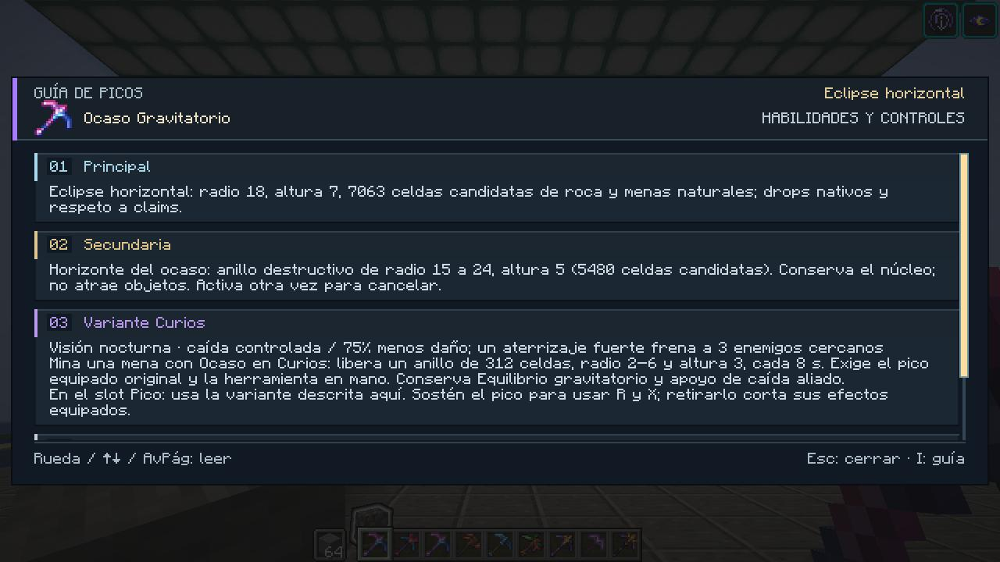

# Ocaso / Eventide — alpha.5 validada

Arte intacto, sin cambios en las clases dedicadas de Iridium/Strata.

## Nueva identidad destructiva

- Primaria **Eclipse horizontal**: disco de radio 18, altura 7, 7063 celdas candidatas; no es una esfera ni un campo de velocidad.
- Segundo modo **Creciente vertical**: mismo disco orientado verticalmente según la dirección horizontal del jugador, radio 18, grosor 7. Se conservan índices y claves persistidas `gravity_in` / `gravity_out` por compatibilidad, pero ya no significan atraer/repeler entidades.
- Secundaria **Horizonte del ocaso**: anillo horizontal de radio 15–24, altura 5, 5480 candidatos. Su núcleo interior permanece intacto deliberadamente. La secundaria repetida cancela.
- Curios **Resplandor residual**: una mena natural minada y confirmada como aire dispara un anillo de radio 2–6, altura 3, 312 candidatos, cada ocho segundos. Se conserva Equilibrio gravitatorio y el apoyo defensivo existente. La misma instancia del slot y la herramienta sostenida son obligatorias durante toda la réplica, incluidos callbacks.
- Copia en mano de Worldbreaker: respeta la selección horizontal/vertical y ejecuta el horizonte secundario. Copia Curios global todavía pendiente.
- Dobles bordes de partículas custom de Ocaso sobre el frente de trabajo; sin modificar PNG/modelos ni crear partículas de equipamiento.

## Seguridad y límites

Minería nativa con durabilidad y drops, permisos por celda, filtros de procedencia/contenedores/fluidos/chunks y contrapresión de drops. Presupuestos globales y límite de trabajo configurado pueden truncar las geometrías. Los recuentos son candidatos máximos, no promesa de bloques rotos.

La réplica no busca menas: observa exclusivamente una rotura manual confirmada. No procesa roturas de su propia cola ni crea una cadena infinita. No mueve objetos ni criaturas, no teletransporta al jugador y no evade claims.

El imán secundario se retira del dispatch y se elimina su método. Las utilidades históricas internas de campos gravitatorios continúan con sus pruebas directas, pero ya no son la habilidad pública de Eventide. Las pruebas de entrada antes dirigidas al imán se sustituyen por controles de contexto, procedencia, claims, ausencia de atracción y geometrías nuevas, sin presentarlas como poderes adicionales.

## Validación

Runtime `6d3439dfe3cc2a09e8e2e206018823bfcb72f992`, CI `44461111246` **SUCCESS**, primer run de alpha.5: **179 JUnit** sin fallos/errores/omisiones, **454 GameTests**, servidor empaquetado y cliente **32 escenas / 64 tooltips**, controles reales y regresiones generales aprobados. Local: **139 Python** (una omisión sin Java), **25 recursos**, secret scan y diff correctos; **58 hashes congelados intactos**. Evidencia descargada en `/tmp/sp605final`.

Captura real de guía ES 1280×720 inspeccionada: `review/eventide-curios-6.0.0-alpha.5-es.jpg`. Muestra eclipse, anillo con núcleo conservado y réplica Curios con tamaño/recarga sin recortar texto; controles accesibles por desplazamiento. No se inspeccionó una captura de la acción destructiva ni todas las escalas e idiomas: no afirmar aprobación estética completa.

JAR `special-pickaxes-1.20.1-6.0.0-alpha.5.jar`: **841023 bytes**, SHA256 `94e76062717068d3b1815de07f52d52d930e5c0aa849db8ea1dcbbdd59b98fc9`. No release 6.0 pública. Quedan siete identidades y copia global Curios de Worldbreaker; no presentar como reforma global final.

