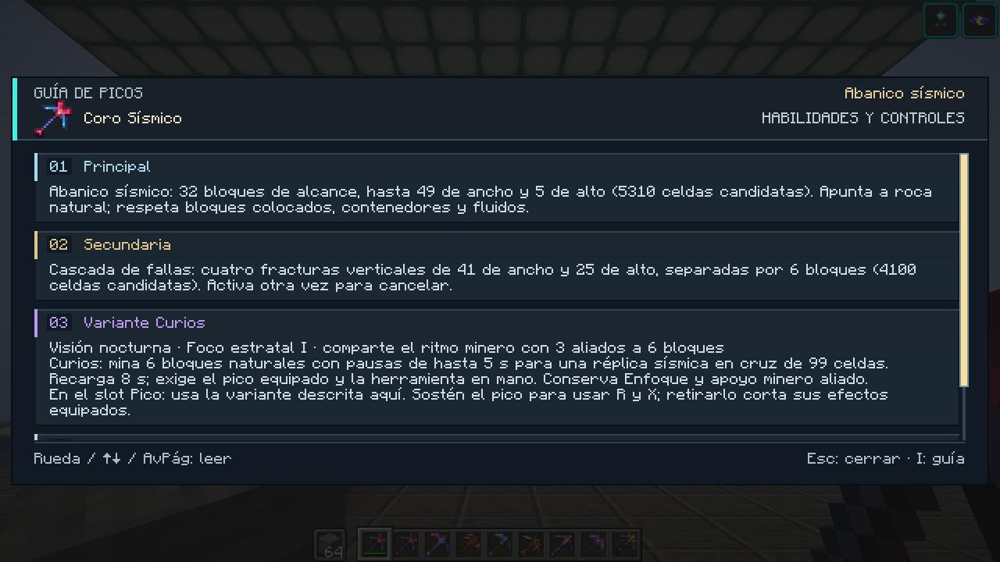

# Coro / Faultsong — alpha.4 validada

Arte de los picos inalterado; Iridium y Strata conservan sus clases dedicadas.

## Identidad nueva

- **Abanico sísmico**, primaria: 32 bloques desde el bloque natural apuntado, de 5 a 49 de ancho, 5 de alto. 5310 celdas candidatas, avance por frentes desde su centro. No depende de memorias ni excava un túnel de sección constante.
- **Cascada de fallas**, secundaria: cuatro fracturas verticales de 41 de ancho y 25 de alto, separadas por 6 bloques. 4100 celdas candidatas; preserva los espacios entre fallas. La secundaria repetida cancela el trabajo.
- **Curios — réplica de minería**: seis cicatrices naturales confirmadas, con pausas de hasta cinco segundos, producen una cruz sísmica de 99 celdas (17 bloques por brazo, tres de alto). Recarga de ocho segundos. Conserva Enfoque y apoyo minero aliado; no sustituye su identidad por una mejora de velocidad.
- Worldbreaker copia en mano ambas geometrías nuevas. La copia global de variantes Curios sigue pendiente.
- Partículas custom existentes del Coro formando un peine sísmico sobre el frente activo; no se modifican texturas ni modelos ni se agrega una aura de equipamiento.
- Textos `en_us`, `es_es`, `es_uy`, catálogo de modos Java y catálogo de escenas Python sincronizados en `fault_fan`.

## Límites y seguridad

Cada inspección consume presupuesto del scheduler compartido y respeta su límite configurable; las cantidades son candidatos, no garantía de drops. Minería nativa con herramienta realmente sostenida, durabilidad, claims, chunks cargados, procedencia, inventarios y fluidos. Conserva la contrapresión de drops.

Las réplicas requieren la misma instancia en el mismo slot durante toda la ejecución. Un guard de transacción scoped revalida esa fuente después de callbacks de habilidad y dentro del evento nativo de rotura, sin cambiar las rutas no equipadas. Retirar o reemplazar el Curios corta su réplica. No procesa roturas de la propia cola, ni bloques colocados, ni minas que no se confirman como aire. Mapa de rachas acotado a 256 dueños y limpiado con el ciclo de observaciones; no hay escaneo mineral.

Las geometrías históricas de galería se conservan como utilidades internas con pruebas de seguridad, pero ya no son las habilidades públicas de Coro. No presentar sus pruebas antiguas como pruebas de la nueva identidad.

## Comprobación

Runtime final `6915c714dade84828787567533fc24eddc7c1135`, CI `44457002693` **SUCCESS**: **176 JUnit**, cero fallos/errores/omisiones; **447 GameTests**; cliente **32 escenas / 64 tooltips**, controles reales y servidor empaquetado aprobados. Local: **139 Python** (una omisión por Java ausente), **25 recursos**, diff/secret scan correctos; los **58 hashes congelados** coinciden. Evidencia descargada en `/tmp/sp604verified`.

Captura real ES 1280×720 inspeccionada: `review/faultsong-curios-6.0.0-alpha.4-es.jpg`. Incluye primaria, secundaria y la réplica Curios con disparador, tamaño y recarga, sin recorte del texto; controles por desplazamiento. Esta inspección no equivale a revisar todas las escalas/idiomas ni a aprobar estéticamente una captura de acción sísmica (no inspeccionada).

JAR `special-pickaxes-1.20.1-6.0.0-alpha.4.jar`: **833548 bytes**, SHA256 `240fa402300e2ed5982a9d804ddd277e2771c8f4f10130e824206794ccb42df7`. No release 6.0 pública ni reforma global completa. Quedan ocho identidades y la copia global Curios de Worldbreaker.

Primera CI `44454022416`: compilación y JUnit aprobados; cuatro fallos GameTest. Retirada del slot durante el callback de contrapresión reveló que el scheduler no revalidaba `done()` antes de `next()`; se corrige esa ventana sin desactivar el guard de equipo. Los otros casos ajustan fixtures: recogida simulada de drops durante ticks síncronos y evitar dos paquetes semánticos en el mismo tick (sin cambiar la contrapresión ni InputThrottle). Revalidación pendiente.

CI `44454732849` (runtime `0873e29724d000226e0430d76caaa4c243535d6f`) SUCCESS: 176 JUnit sin fallos/errores/omisiones, 447 GameTests, cliente 32 escenas/64 tooltips y servidor empaquetado. Sin embargo, la captura real del manual inspeccionada mostró que la tarjeta Curios usaba sólo el resumen pasivo, omitiendo los detalles nuevos. Se conecta `curios.detail` para los trece picos y se corrige el texto genérico obsoleto; se actualiza la antigua prueba que prohibía esos detalles, contraria a la petición actual. La corrección gráfica aún requiere nueva CI. No reutilizar la captura con omisión como prueba de una guía completa.

La CI final indicada arriba incluye la corrección de la guía para los trece picos. La tarjeta usa el tipo nativo para describir Curios: no atribuye a Worldbreaker una copia equipada aún no implementada. La guía sigue siendo desplazable y no se reintroducen el HUD ni la expansión SHIFT.
